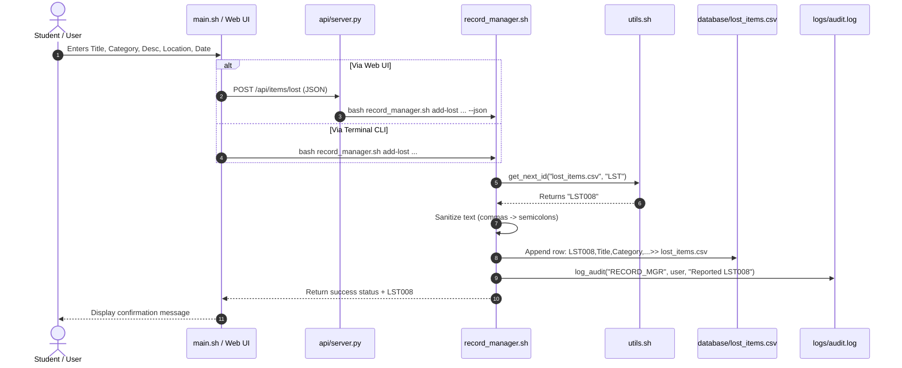
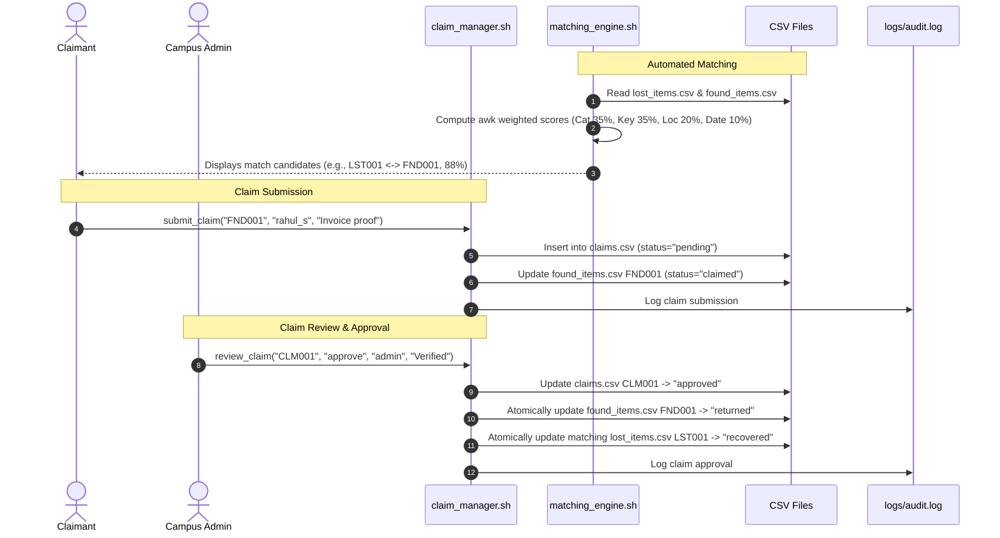

# LostLink: Complete Project Technical Context & System Analysis

> **Target Audience**: AI Tutor / Viva Presentation Coach (ChatGPT)  
> **Course**: Unix and Shell Scripting (Academic Laboratory Project)  
> **Repository**: [https://github.com/ManojKumarC0112/LostLink](https://github.com/ManojKumarC0112/LostLink)  
> **Primary Technology Stack**: GNU Bash (75%), Python `http.server` Bridge (5%), React 18 SPA (20%), Flat CSV Files (Storage)

---

## 1. Project Overview & System Philosophy

### 1.1 Objective and Problem Statement
On university campuses, thousands of items (electronics, IDs, wallets, keys, notebooks) are misplaced every semester. Traditional campus lost-and-found desks rely on physical paper registers or disconnected WhatsApp/email groups. Where digital systems exist, they are almost universally built as conventional full-stack web applications (e.g., MERN, Django, Spring Boot) backed by SQL/NoSQL databases, burying the fundamental capabilities of operating system environments.

**LostLink** addresses this problem by reversing the standard paradigm:
* **The Core Principle**: **Bash is the application; the website is its presentation interface.**
* **The Academic Goal**: To prove that an enterprise-grade, multi-user, multi-featured campus application can be engineered entirely using **Linux/Unix shell scripts, POSIX text utilities (`awk`, `sed`, `grep`, `sort`, `uniq`, `tar`, `find`), and flat-file delimited data structures**.

### 1.2 Main Features Currently Implemented
1. **Flat-File CRUD Management**: Full lifecycle management of lost and found items stored in RFC-style CSV files with atomic writes.
2. **Sequential Alphanumeric ID Generator**: Dynamically calculates and formats consecutive IDs (`LST001`, `FND001`, `CLM001`) by inspecting existing file headers and rows using Unix pipelines.
3. **Multi-Criteria Unix Search Engine**: Case-insensitive substring and regex filtering across title, description, location, category, and date with multi-column sorting.
4. **Smart Weighted Matching Engine**: An AI-style heuristic matching algorithm written in POSIX `awk` that scores lost-and-found candidate pairs across four weighted factors (Category 35%, Keywords 35%, Location 20%, Date 10%).
5. **Relational Claim Management**: Submitting, reviewing, and approving claims with cross-table synchronization (updating `claims.csv`, `found_items.csv` to `returned`, and `lost_items.csv` to `recovered`).
6. **Chronological Audit Logging**: Append-only event tracking (`logs/audit.log`) recording timestamps, modules, usernames, and action descriptions.
7. **Multi-File Analytical KPI Aggregator**: Single-pass `awk` execution across multiple CSV streams calculating total counts, recovery rates, and identifying campus loss hotspots.
8. **Automated Multi-Format Reporting**: Automatic compilation of periodic summaries (daily, weekly, monthly) into formatted terminal text and styled responsive HTML.
9. **Cryptographically Verified Backup & Restore**: Creates `.tar.gz` snapshots, generates SHA-256 checksum signatures, automatically purges archives older than 7 days using `find -mtime`, and verifies checksums prior to extraction.
10. **Hardware & Process Resource Monitor**: Live extraction of hostname, OS kernel, uptime, load average, disk usage (`df -h`), memory utilization (`free -m`), top active processes (`ps aux`), and database file statistics.
11. **Master Interactive Terminal CLI (`main.sh`)**: A clean, consolidated interactive menu for faculty evaluation and lab vivas with cross-platform input sanitization (`\r`).
12. **Zero-Dependency Python HTTP Bridge (`api/server.py`)**: A 289-line bridge executing Bash scripts via `subprocess.run` and returning structured JSON to frontend clients.
13. **React 18 SaaS Dashboard (`frontend/index.html`)**: A modern, single-page application built with Tailwind CSS, Lucide icons, and responsive tabs for student and admin interactions.

---

## 2. In-Depth Module Analysis

### 2.1 `backend/utils.sh` (Shared Core Library)
* **Purpose**: Serves as the central utility library sourced by all other Bash scripts. Defines project directory paths, ANSI color constants, audit logging routines, sequential ID generation, and CSV-to-JSON serialization.
* **Internal Mechanics**:
  * Uses `BASH_SOURCE[0]` to resolve the project root dynamically, making the scripts location-agnostic.
  * Formats text using ANSI escape codes for color-coded terminal UX.
  * Employs standard `awk` to convert flat CSV rows into RFC-compliant JSON arrays without requiring third-party libraries like `jq`.
* **Important Functions**:
  * `ensure_dirs()`: Verifies and creates `database/`, `logs/`, `reports/`, `backups/`, and `cron/`.
  * `log_audit(module, user, details)`: Appends timestamped audit entries to `logs/audit.log`.
  * `get_next_id(file, prefix)`: Calculates the next sequential alphanumeric identifier.
  * `csv_to_json(file)`: Streams CSV records into an array of JSON objects.
* **Unix Commands Used**: `mkdir -p`, `tail`, `cut`, `grep`, `sed`, `sort`, `printf`, `awk`, `date`.
* **Key Code Example**:
  ```bash
  get_next_id() {
      local file="$1"
      local prefix="$2"
      if [[ ! -f "$file" ]] || [[ $(wc -l < "$file") -le 1 ]]; then
          echo "${prefix}001"
          return
      fi
      local max_num
      max_num=$(tail -n +2 "$file" | cut -d',' -f1 | grep "^$prefix" | sed "s/^$prefix//" | sort -n | tail -n 1)
      if [[ -z "$max_num" ]]; then
          echo "${prefix}001"
      else
          printf "%s%03d\n" "$prefix" $((10#$max_num + 1))
      fi
  }
  ```
* **Dependencies**: None (base library).

---

### 2.2 `backend/record_manager.sh` (Record Management & Authentication)
* **Purpose**: Implements CRUD (Create, Read, Update, Delete) operations for lost items, found items, and user registration/authentication.
* **Internal Mechanics**:
  * Validates user credentials against `database/users.csv`.
  * Sanitizes string inputs by replacing internal commas with semicolons (`title="${title//,/;}"`) to maintain CSV field boundaries.
  * Executes atomic row updates and deletions via temporary files.
* **Important Functions**:
  * `authenticate_user(username, password, [output_json])`: Verifies login credentials using `grep`.
  * `register_user(username, password, full_name, email, role, [output_json])`: Creates user accounts after verifying uniqueness.
  * `add_lost_item(...)` / `add_found_item(...)`: Formats row entries, generates timestamps, and appends to CSV.
  * `list_items(type, status_filter, [output_json])`: Formats records as an aligned terminal table or JSON array.
  * `update_status(type, id, new_status, user, [output_json])`: Updates column 9 (`status`) atomically.
  * `delete_item(type, id, user, [output_json])`: Removes records using `grep -v`.
* **Unix Commands Used**: `grep`, `awk`, `cut`, `mktemp`, `mv`, `tr`, `head`, `tail`, `wc`, `date`.
* **Key Code Example (Atomic Update Pattern)**:
  ```bash
  local temp_file
  temp_file=$(mktemp)
  awk -F',' -v id="$item_id" -v nst="$new_status" '
  BEGIN { OFS="," }
  {
      if ($1 == id) { $9 = nst }
      print $0
  }
  ' "$target_csv" > "$temp_file" && mv "$temp_file" "$target_csv"
  ```
* **Dependencies**: Sources `backend/utils.sh`. Reads/writes `database/lost_items.csv`, `database/found_items.csv`, `database/users.csv`.

---

### 2.3 `backend/search_engine.sh` (Advanced Multi-Criteria Search)
* **Purpose**: Performs high-speed searching, multi-field filtering, and dynamic sorting across lost and found inventories.
* **Internal Mechanics**:
  * Combines `lost_items.csv` and `found_items.csv` into a temporary stream, tagging each record with its type (`LOST` or `FOUND`).
  * Passes filter parameters (`keyword`, `category`, `location`, `status`) into `awk`.
  * In `awk`, string matching is performed case-insensitively using `tolower()` and `index()`.
  * Pipes filtered records into Unix `sort` using field delimiters (`-t','`).
* **Important Functions**:
  * `execute_search(type, keyword, category, location, status, sort_by, output_mode)`: The main search pipeline.
* **Unix Commands Used**: `awk`, `grep`, `sort`, `cut`, `mktemp`, `rm`, `wc`, `tail`.
* **Key Code Example**:
  ```bash
  awk -F',' -v kw="$keyword" -v cat="$category" -v loc="$location" -v stat="$status" '
  BEGIN {
      kw = tolower(kw); cat = tolower(cat); loc = tolower(loc); stat = tolower(stat)
  }
  {
      row_type = $1; row_id = $2; row_title = $3; row_cat = $4; row_desc = $5; row_loc = $6; row_date = $7; row_stat = $10

      if (kw != "" && kw != "all") {
          full_text = tolower(row_title " " row_desc " " row_loc " " row_cat)
          if (index(full_text, kw) == 0) next
      }
      if (cat != "" && cat != "all" && tolower(row_cat) != cat) next
      if (loc != "" && loc != "all" && index(tolower(row_loc), loc) == 0) next
      if (stat != "" && stat != "all" && tolower(row_stat) != stat) next

      print $0
  }
  ' "$temp_combined" > "$temp_filtered"
  ```
* **Dependencies**: Sources `backend/utils.sh`. Reads `database/lost_items.csv` and `database/found_items.csv`.

---

### 2.4 `backend/matching_engine.sh` (Smart Weighted Matching Engine)
* **Purpose**: Implements an automated matching algorithm that pairs active lost items with found items and assigns a percentage match score with confidence classification.
* **Internal Mechanics**:
  * Loops through all unresolved lost items (`status != "recovered"` and `status != "closed"`).
  * Compares each lost item against all unreturned found items (`status != "returned"` and `status != "closed"`).
  * Executes an inline `awk` script that evaluates four distinct dimensions:
    1. **Category (35 points)**: Exact case-insensitive category match.
    2. **Keywords (35 points)**: Punctuation is stripped with `gsub(/[^a-z0-9 ]/, " ")`. Text is split into words. English stop words are filtered out using an inline space-padded string check (`index(stop_words, " " w " ")`). Meaningful words from the lost item populate an associative dictionary `l_dict`. Overlapping words from the found item increment `matches`. The Jaccard-like overlap is scaled to 35 points.
    3. **Location (20 points)**: Exact match gives 20 points. Substring token matches (e.g., "Library", "Cafeteria") award 15 points.
    4. **Date (10 points)**: Dates (`YYYY-MM-DD`) are converted into approximate day counts. Differences $\le 2$ days award 10 points; $\le 7$ days award 5 points.
  * Pairs scoring $\ge 70\%$ are classified as `HIGH`, $45-69\%$ as `MODERATE`, and $25-44\%$ as `LOW`.
* **Important Functions**:
  * `calculate_match_score(...)`: Evaluates a single pair of item records.
  * `run_matching_all(output_mode, min_threshold)`: Runs cross-comparison and sorts output descending by score (`sort -t'|' -k1,1nr`).
* **Unix Commands Used**: `awk`, `sort`, `cut`, `mktemp`, `rm`, `wc`.
* **Key Code Example**:
  ```awk
  stop_words = " the a an in on with and of to is for by my at near under from on floor room block desk "
  clean_ltext = tolower(ltext); gsub(/[^a-z0-9 ]/, " ", clean_ltext)
  n_l = split(clean_ltext, words_l, " ")
  for (i=1; i<=n_l; i++) {
      w = words_l[i]
      if (length(w) > 2 && index(stop_words, " " w " ") == 0) { l_dict[w] = 1 }
  }
  ```
* **Dependencies**: Sources `backend/utils.sh`. Reads `database/lost_items.csv` and `database/found_items.csv`.

---

### 2.5 `backend/claim_manager.sh` (Claim Processing & Relational Sync)
* **Purpose**: Manages the verification workflow when a student claims a found item, coordinating status changes across multiple files.
* **Internal Mechanics**:
  * Ensures that items already marked `returned` or `closed` cannot be claimed.
  * Appends new claims with status `pending` to `database/claims.csv`.
  * Updates the corresponding item in `database/found_items.csv` to `claimed`.
  * When an administrator approves a claim:
    1. Sets claim status to `approved` and records review notes and timestamps in `claims.csv`.
    2. Atomically changes the item status in `found_items.csv` to `returned`.
    3. Searches `database/lost_items.csv` for any record belonging to the claimant with status `matched` and automatically transitions it to `recovered`.
* **Important Functions**:
  * `submit_claim(found_item_id, claimed_by, proof_details, [output_json])`
  * `list_claims(status_filter, [output_json])`
  * `review_claim(claim_id, decision, reviewer, notes, [output_json])`
* **Unix Commands Used**: `grep`, `awk`, `cut`, `mktemp`, `mv`, `date`.
* **Dependencies**: Sources `backend/utils.sh`. Modifies `database/claims.csv`, `database/found_items.csv`, and `database/lost_items.csv`.

---

### 2.6 `backend/audit_logger.sh` (Security & Activity Audit)
* **Purpose**: Provides immutable chronological event logging for accountability and security review.
* **Internal Mechanics**:
  * Appends log entries to `logs/audit.log` in the standard format:
    `[YYYY-MM-DD HH:MM:SS] [MODULE] [USER] Details...`
  * Uses `tail -n` to limit log output to the most recent events.
  * Uses `grep -i` for keyword filtering (by module, user, or event).
  * Employs `awk` regex capture matching `match($0, /^\[([0-9\-: ]+)\] \[([A-Z_]+)\] \[([a-zA-Z0-9_\.]+)\] (.*)$/, arr)` to parse log lines into JSON.
* **Important Functions**:
  * `record_log(module, user, message)`
  * `view_logs(limit, filter_kw, output_mode)`
* **Unix Commands Used**: `tail`, `grep`, `awk`, `date`.
* **Dependencies**: Sources `backend/utils.sh`. Reads and appends to `logs/audit.log`.

---

### 2.7 `backend/analytics.sh` (Campus Metrics & Hotspot Analysis)
* **Purpose**: Aggregates statistical metrics and identifies loss hotspots across campus facilities.
* **Internal Mechanics**:
  * Executes a single-pass `awk` command across three distinct input streams (`lost_items.csv`, `found_items.csv`, `claims.csv`) by checking `FILENAME`.
  * Computes campus recovery rate: $\frac{\text{Returned Items}}{\text{Total Lost Items}} \times 100\%$.
  * Builds an associative array of incident frequencies per campus location (`locs[$5]++`).
  * Pipes location counts to `sort -t'|' -k1,1nr | head -n 5` to extract the top 5 incident hotspots.
* **Important Functions**:
  * `get_analytics(output_mode)`: Outputs summary table or structured JSON.
* **Unix Commands Used**: `awk`, `sort`, `cut`, `head`, `sed`, `printf`.
* **Key Code Example**:
  ```bash
  awk -F',' '
  FNR > 1 && FILENAME ~ /lost_items\.csv$/ { locs[$5]++ }
  END {
      for (l in locs) printf "%d|%s\n", locs[l], l
  }
  ' "$LOST_CSV" | sort -t'|' -k1,1nr | head -n 5
  ```
* **Dependencies**: Sources `backend/utils.sh`. Reads all database CSV files.

---

### 2.8 `backend/report_generator.sh` (Automated Report Compiler)
* **Purpose**: Compiles operational reports in both plain text (`.txt`) and styled responsive HTML (`.html`).
* **Internal Mechanics**:
  * Fetches real-time JSON metrics by invoking `analytics.sh stats --json`.
  * Extracts lost records, found records, pending claims, and recent audit trails using `awk`.
  * Uses Unix heredocs (`cat <<EOF > "$path"`) to compile text and HTML files with CSS styling and badges.
  * Saves files into `reports/` with timestamped naming conventions (`report_<type>_<YYYYMMDD_HHMMSS>.*`).
* **Important Functions**:
  * `generate_report(report_type, format, generated_by)`
* **Unix Commands Used**: `cat`, `date`, `awk`, `grep`, `tr`, `ls`, `tail`.
* **Dependencies**: Sources `backend/utils.sh`. Calls `backend/analytics.sh`. Writes to `reports/`.

---

### 2.9 `backend/backup_restore.sh` (Archival, Integrity & Rotation)
* **Purpose**: Manages compressed data backups, cryptographic signatures, rolling retention policies, and safe database restoration.
* **Internal Mechanics**:
  * **Archive Creation**: Compresses `database/`, `logs/`, and `reports/` using `tar -czf`.
  * **Integrity Hashing**: Generates an SHA-256 digest via `sha256sum` (or `shasum -a 256`) and saves it to `.sha256`.
  * **Automated Rotation**: Enforces retention policies by finding and purging archives older than $N$ days (`find "$BACKUP_DIR" -name "*.tar.gz" -mtime +"$retention_days" -delete`).
  * **Integrity-Verified Restore**: Compares the archive's current SHA-256 digest against the stored digest. If verified, extracts the files via `tar -xzf`.
* **Important Functions**:
  * `calc_sha256(target)`: Cross-platform hash helper.
  * `create_backup(retention_days, output_json, user)`
  * `list_backups(output_mode)`: Inspects existing tarballs and verifies checksums.
  * `restore_backup(target_filename, output_json, user)`
* **Unix Commands Used**: `tar`, `gzip`, `sha256sum`, `shasum`, `find`, `ls`, `date`, `awk`, `basename`.
* **Dependencies**: Sources `backend/utils.sh`. Manages `backups/`, `database/`, `logs/`, and `reports/`.

---

### 2.10 `backend/system_monitor.sh` (Host Resource & Process Diagnostics)
* **Purpose**: Monitors server hardware resource utilization, process workloads, and database flat-file capacities.
* **Internal Mechanics**:
  * Queries host details via `hostname` and `uname -srm`.
  * Retrieves system uptime and load averages via `uptime`.
  * Gathers filesystem space on the project partition using `df -h`.
  * Inspects physical memory utilization using `free -m` (or fallback).
  * Captures active processes using `ps aux | head -n 6`.
  * Calculates line counts of all database CSV files using `wc -l`.
* **Important Functions**:
  * `get_system_metrics(output_mode)`
* **Unix Commands Used**: `hostname`, `uname`, `uptime`, `df`, `free`, `ps`, `wc`, `awk`, `cut`, `tr`.
* **Dependencies**: Sources `backend/utils.sh`. Reads database files and system binaries.

---

### 2.11 `backend/main.sh` (Master Terminal Application)
* **Purpose**: The primary interactive CLI presentation menu for faculty evaluation and viva defense.
* **Internal Mechanics**:
  * Presents a clean, non-redundant, numbered 7-option main menu.
  * Employs a continuous `while true` event loop with `case` selection.
  * Implements cross-platform carriage-return stripping (`choice="${choice//$'\r'/}"`) to prevent input errors on Windows Git Bash, WSL, and native Linux.
* **Menu Routing**:
  * `[1]` Lost & Found Records $\rightarrow$ `menu_records()`
  * `[2]` Search & Filter Records $\rightarrow$ `menu_search()`
  * `[3]` Smart Matching Engine $\rightarrow$ `menu_matching()`
  * `[4]` Claim Management $\rightarrow$ `menu_claims()`
  * `[5]` Analytics & Reports $\rightarrow$ `menu_analytics_reports()`
  * `[6]` Backup & Restore $\rightarrow$ `menu_backup_restore()`
  * `[7]` System Monitor & Logs $\rightarrow$ `menu_system_logs()`
  * `[0]` Exit
* **Dependencies**: Sources `backend/utils.sh` and dispatches execution to all other modules.

---

### 2.12 `cron/backup_cron.sh` (Automated Background Scheduler)
* **Purpose**: Unattended script executed by the system `cron` daemon at scheduled intervals.
* **Internal Mechanics**:
  * Resolves project paths relative to its own location.
  * Appends execution timestamps to `logs/cron.log`.
  * Executes `bash "$BACKEND_DIR/backup_restore.sh" create 7`.
  * Captures stdout and stderr, logging success or failure exit codes.
* **Crontab Setup**:
  ```cron
  0 0 * * * /path/to/LostLink/cron/backup_cron.sh >> /path/to/LostLink/logs/cron.log 2>&1
  ```
* **Dependencies**: Calls `backend/backup_restore.sh`. Writes to `logs/cron.log`.

---

### 2.13 `api/server.py` (Zero-Dependency Python HTTP Bridge)
* **Purpose**: Bridges web browser REST API calls to the Bash backend scripts.
* **Internal Mechanics**:
  * Implemented using Python's built-in `http.server.HTTPServer` and `SimpleHTTPRequestHandler` — requires **no external packages** (no Flask, Django, or requests needed).
  * Automatically detects the appropriate Bash binary (`C:\Program Files\Git\bin\bash.exe`, WSL, or `/bin/bash`).
  * Intercepts `GET` and `POST` requests, extracts query strings and JSON payloads, and invokes the corresponding shell script using `subprocess.run()`.
  * Forwards stdout directly back to the browser with standard CORS headers (`Access-Control-Allow-Origin: *`).
  * Serves frontend assets directly from `frontend/`.
* **Key Endpoints**:
  * `GET /api/stats` $\rightarrow$ `analytics.sh stats --json`
  * `GET /api/items/lost` $\rightarrow$ `record_manager.sh list lost all --json`
  * `GET /api/items/found` $\rightarrow$ `record_manager.sh list found all --json`
  * `GET /api/search` $\rightarrow$ `search_engine.sh search ... --json`
  * `GET /api/matches` $\rightarrow$ `matching_engine.sh match-all --json`
  * `GET /api/claims` $\rightarrow$ `claim_manager.sh list all --json`
  * `GET /api/system` $\rightarrow$ `system_monitor.sh status --json`
  * `GET /api/backups` $\rightarrow$ `backup_restore.sh list --json`
  * `GET /api/logs` $\rightarrow$ `audit_logger.sh view ... --json`
  * `POST /api/items/lost` $\rightarrow$ `record_manager.sh add-lost ...`
  * `POST /api/items/found` $\rightarrow$ `record_manager.sh add-found ...`
  * `POST /api/claims` $\rightarrow$ `claim_manager.sh submit ...`
  * `POST /api/claims/review` $\rightarrow$ `claim_manager.sh review ...`
  * `POST /api/backups` $\rightarrow$ `backup_restore.sh create ...`
  * `POST /api/reports/generate` $\rightarrow$ `report_generator.sh generate ...`
* **Dependencies**: Python standard library (`subprocess`, `http.server`, `json`, `pathlib`, `shutil`).

---

### 2.14 Frontend Architecture (`frontend/index.html`)
* **Purpose**: Presentation layer providing a modern SaaS-style user experience.
* **Internal Mechanics**:
  * Developed as a self-contained single-page application using React 18, Babel Standalone, and Tailwind CSS loaded via CDN.
  * Contains tabs for Dashboard, Lost Items, Found Items, Smart Matching, Claims, Search, Analytics, Reports, Backups, Unix Monitor, and Audit Logs.
  * Dispatches standard `fetch()` requests to `http://localhost:5000/api/...`.
  * Performs **zero business logic in JavaScript** — all computations, filtering, sorting, and matches are performed by the Bash scripts.

---

## 3. Unix and Shell Scripting Concepts Catalog

Every major concept from standard operating systems curricula is implemented in LostLink:

| Unix Concept | Where Used in LostLink | Code Example from Project |
| :--- | :--- | :--- |
| **Shebang (`#!/usr/bin/env bash`)** | Top line of all `.sh` scripts | `#!/usr/bin/env bash` |
| **Positional Parameters** | CLI routers in all scripts | `case "${1:-}" in search) execute_search "$2" "$3" ;; esac` |
| **Variable Default Expansion** | Setting fallback values | `local status_filter="${2:-all}"` |
| **String Manipulation in Bash** | Comma and newline sanitization | `title="${title//,/;}"` and `ch="${ch//$'\r'/}"` |
| **Local Variable Scoping** | Keeping function variables isolated | `local temp_file; local item_id` |
| **Exit Status & Conditionals** | Checking execution status | `if ! grep -q "^$item_id," "$target_csv"; then return 1; fi` |
| **While Event Loops** | Interactive CLI menus | `while true; do read -rp "Choice: " ch; case "$ch" in ... esac; done` |
| **Standard Redirection (`>`, `>>`)** | File writes & logging | `echo "[$timestamp] [$module] $msg" >> "$AUDIT_LOG"` |
| **Pipes (`\|`)** | Chaining stream processing | `tail -n +2 "$file" \| cut -d',' -f1 \| sort -n \| tail -n 1` |
| **Command Substitution (`$(...)`)** | Capturing command output | `max_num=$(tail -n +2 "$file" \| cut -d',' -f1)` |
| **Atomic File Swapping** | Preventing CSV write corruption | `awk '...' "$CSV" > "$TEMP" && mv "$TEMP" "$CSV"` |
| **Temporary File Creation (`mktemp`)** | Safe scratchpad creation | `temp_file=$(mktemp)` |
| **`grep` (Search & Filter)** | User auth, item lookup, line deletions | `grep -v "^$item_id," "$target_csv" > "$temp_file"` |
| **`awk` (Data Processing)** | Scoring, CSV-to-JSON, analytics | `awk -F',' -v id="$item_id" '$1 == id { $9 = "returned" }'` |
| **`sed` (Stream Editor)** | Prefix extraction, formatting | `sed "s/^$prefix//"` |
| **`cut` (Column Extraction)** | Field slicing from CSV | `cut -d',' -f1` |
| **`sort` (Multi-Field Sort)** | Sorting dates, IDs, match scores | `sort -t',' -k7,7r "$temp_filtered"` |
| **`uniq` (Deduplication)** | Counting unique occurrences | `sort \| uniq -c` |
| **`tr` (Translation & Deletion)** | Case conversion, character deletion | `tr '[:lower:]' '[:upper:]'` and `tr -d '%'` |
| **`wc` (Word/Line Count)** | Counting database rows & matches | `count=$(wc -l < "$temp_sorted")` |
| **`find` (File Search & Retention)** | Rolling 7-day backup purging | `find "$BACKUP_DIR" -name "*.tar.gz" -mtime +7 -delete` |
| **`tar` & `gzip` (Archiving)** | Full database and log snapshots | `tar -czf "$archive_path" database/ logs/ reports/` |
| **`sha256sum` (Integrity)** | Generating & checking hashes | `sha256sum "$archive" \| awk '{print $1}' > "$checksum"` |
| **System Diagnostics** | Inspecting host OS and hardware | `df -h`, `free -m`, `uptime`, `ps aux`, `uname -srm` |
| **`cron` (Scheduled Daemons)** | Nightly unattended backups | `0 0 * * * /path/to/backup_cron.sh` |

---

## 4. Algorithms & Core Logic Walkthrough

### 4.1 Lost & Found Item Matching Algorithm
The algorithm in `backend/matching_engine.sh` runs entirely in `awk`. It calculates a composite match score ($0-100\%$) for candidate item pairs:

$$\text{Total Score} = S_{\text{category}} (35\%) + S_{\text{keywords}} (35\%) + S_{\text{location}} (20\%) + S_{\text{date}} (10\%)$$

#### Step-by-Step Execution:
1. **Category Score ($S_{\text{cat}}$)**:
   * Compares `tolower(l_cat)` with `tolower(f_cat)`.
   * If identical $\rightarrow 35$ points. Otherwise $\rightarrow 0$ points.
2. **Keyword Overlap Score ($S_{\text{key}}$)**:
   * Cleans text using `gsub(/[^a-z0-9 ]/, " ", clean_text)`.
   * Splits into individual word tokens.
   * Compares each word against an inline list of 25 stop words (`the`, `with`, `and`, `for`, `near`, `floor`, etc.).
   * Words with length $> 2$ not in the stop list populate associative array `l_dict`.
   * For the found item, matching words increment `matches`.
   * $\text{Score} = \text{int}\left(\frac{\text{matches}}{\text{total\_unique}} \times 35\right)$. If at least one explicit keyword matches, a baseline of 10 points is awarded.
3. **Location Proximity Score ($S_{\text{loc}}$)**:
   * If exact string match $\rightarrow 20$ points.
   * If shared building token (e.g., both contain "Library", "Cafeteria", "Science") $\rightarrow 15$ points.
   * Otherwise $\rightarrow 0$ points.
4. **Date Proximity Score ($S_{\text{date}}$)**:
   * Converts `YYYY-MM-DD` strings into approximate day values:
     $$\text{Days} = \text{Year} \times 365 + \text{Month} \times 30 + \text{Day}$$
   * Computes difference: $\Delta = |\text{Days}_{\text{lost}} - \text{Days}_{\text{found}}|$.
   * If $\Delta \le 2$ days $\rightarrow 10$ points.
   * If $\Delta \le 7$ days $\rightarrow 5$ points.
   * Otherwise $\rightarrow 0$ points.
5. **Classification**:
   * $\ge 70\% \rightarrow$ **HIGH CONFIDENCE**
   * $45\% - 69\% \rightarrow$ **MODERATE MATCH**
   * $25\% - 44\% \rightarrow$ **LOW MATCH**

---

### 4.2 Multi-Criteria Search Algorithm
Located in `backend/search_engine.sh`:
1. Concatenates lost and found records into a combined stream with prepended source tags.
2. `awk` reads the stream with parameters `kw`, `cat`, `loc`, `stat`.
3. Concatenates `title`, `description`, `location`, and `category` into `full_text`.
4. If `kw` is provided, checks `index(tolower(full_text), kw) > 0`. Rows without a match are discarded via `next`.
5. Exact category and partial location checks follow.
6. Surviving rows are sorted via `sort` (`-k7,7r` for descending dates).

---

### 4.3 Atomic File Write Pattern
To prevent race conditions or data loss:
```text
Original CSV -----> [awk reads original]
                         |
                         v
                    [Writes to /tmp/temp.XXXXXX via mktemp]
                         |
                         v
                    [mv -f overwrites Original CSV atomically]
```
In POSIX systems, `mv` within the same filesystem replaces directory entries via an atomic `rename()` system call.

---

### 4.4 Backup Integrity & Auto-Rotation Logic
In `backend/backup_restore.sh`:
```text
Create Backup:
  1. tar -czf backups/lostlink_backup_TIMESTAMP.tar.gz database/ logs/ reports/
  2. sha256sum archive.tar.gz > archive.tar.gz.sha256
  3. find backups/ -name "*.tar.gz" -mtime +7 -delete

Restore Backup:
  1. Read stored hash from archive.tar.gz.sha256
  2. Compute current hash: sha256sum archive.tar.gz
  3. If stored == current:
       tar -xzf archive.tar.gz
     Else:
       Abort with "CORRUPTED ARCHIVE" error
```

---

## 5. System Architecture & Execution Flows

### 5.1 System Architecture Diagram

```mermaid
flowchart TD
    subgraph Client_Layer ["Client Tier (20%)"]
        Browser["React 18 SPA (Browser)"]
        TerminalCLI["Terminal User (main.sh)"]
    end

    subgraph Bridge_Layer ["API Bridge Tier (5%)"]
        PyServer["api/server.py (Python http.server)"]
    end

    subgraph Engine_Layer ["Bash Application Engine (75%)"]
        MainCLI["backend/main.sh (Master Menu)"]
        RecordMgr["backend/record_manager.sh"]
        SearchEng["backend/search_engine.sh"]
        MatchEng["backend/matching_engine.sh"]
        ClaimMgr["backend/claim_manager.sh"]
        Analytics["backend/analytics.sh"]
        ReportGen["backend/report_generator.sh"]
        BackupRest["backend/backup_restore.sh"]
        SysMon["backend/system_monitor.sh"]
        AuditLog["backend/audit_logger.sh"]
        Utils["backend/utils.sh (Common Library)"]
        CronJob["cron/backup_cron.sh"]
    end

    subgraph Storage_Layer ["POSIX Storage Tier"]
        CSV_DB[("Flat CSV Files\n(users, lost, found, claims)")]
        Logs[("logs/audit.log & cron.log")]
        Reports[("reports/*.txt & *.html")]
        Backups[("backups/*.tar.gz & *.sha256")]
    end

    Browser -->|HTTP GET/POST JSON| PyServer
    PyServer -->|subprocess.run| Engine_Layer
    TerminalCLI --> MainCLI
    MainCLI --> Engine_Layer
    CronJob -->|Scheduled 0 0 * * *| BackupRest

    RecordMgr --> CSV_DB
    SearchEng --> CSV_DB
    MatchEng --> CSV_DB
    ClaimMgr --> CSV_DB
    Analytics --> CSV_DB
    ReportGen --> Reports
    BackupRest --> Backups
    AuditLog --> Logs
    SysMon --> Storage_Layer

    Engine_Layer -.-> Utils
```



---

### 5.2 Flow: Reporting a Lost Item



---

### 5.3 Flow: Item Matching & Claim Approval



---

## 6. Presentation Preparation (5–7 Minute Defense)

### 6.1 Slide Structure

* **Slide 1: Title & Vision**
  * *Title*: LostLink — Unix & Shell Scripting Campus Lost & Found System
  * *Subtitle*: Proving that GNU Bash and POSIX utilities can serve as an application engine.
  * *Core Premise*: Bash is the application; the website is its presentation interface.
* **Slide 2: Architecture & Philosophy**
  * Unix Philosophy: Small modular programs, text stream pipes, flat files.
  * System distribution: 75% Bash / 5% Python Bridge / 20% React Dashboard.
* **Slide 3: Member 1 — Data Storage & Atomic Updates**
  * Flat CSV structure; avoiding database daemons.
  * Sequential ID generation pipeline (`tail | cut | sort | printf`).
  * Atomic file swap pattern with `mktemp` and `mv`.
* **Slide 4: Member 2 — Search & Smart Weighted Matching**
  * Dynamic multi-criteria search using `awk` case-insensitivity.
  * The 4-factor scoring algorithm in `awk`: Category (35%), Keywords (35%), Location (20%), Date (10%).
  * Stop-word removal and associative dictionary tokenization.
* **Slide 5: Member 3 — Claim Workflow & Security Audit Trail**
  * Multi-file state synchronization (`claimed` $\rightarrow$ `returned` $\rightarrow$ `recovered`).
  * Immutable event streaming via append redirection (`>>`) into `logs/audit.log`.
* **Slide 6: Member 4 — Analytics, Automated Backups & System Health**
  * Multi-file stream analysis in a single `awk` pass for recovery rate.
  * Location hotspot analysis using `sort | head`.
  * `tar -czf` archiving with SHA-256 integrity verification.
  * Unattended 7-day rolling rotation via `find -mtime` and `cron`.
* **Slide 7: Live Demonstration**
  * Terminal-first execution via `backend/main.sh`.
  * Running the Smart Matching Engine.
  * Creating a verified backup archive.
* **Slide 8: Conclusion & Viva Readiness**
  * Summary of Unix tools mastered: `awk`, `sed`, `grep`, `cut`, `sort`, `uniq`, `tar`, `sha256sum`, `cron`, `df`, `ps`.

---

### 6.2 Demonstration Sequence (Commands to Run)

Execute these commands in order during the live presentation:

```bash
# Step 1: Launch the Master Interactive Terminal Menu
bash backend/main.sh

# Action: Select option [3]
# Demonstrates: Smart Matching Engine calculating weighted percentages live.

# Action: Select option [5] -> [1]
# Demonstrates: Analytics, Campus Recovery Rate (%), and Top 5 Loss Hotspots.

# Action: Select option [6] -> [1]
# Demonstrates: Creating a compressed backup with SHA-256 checksum and auto-rotation.

# Step 2: Run a standalone search command directly from the shell
bash backend/search_engine.sh search all "Library"

# Step 3 (Optional): Start the Web Dashboard
python api/server.py
# Open http://localhost:5000 to show the visual presentation tier.
```

---

## 7. Viva Preparation (40 Questions & Technical Answers)

### Section A: Project Architecture & Design Decisions
1. **Q: Why did you build this in Bash instead of Node.js or Python?**  
   *A:* To fulfill the core objective of the Unix and Shell Scripting curriculum. We demonstrate that core POSIX utilities (`awk`, `sed`, `grep`, `sort`, `tar`) can implement business logic, data filtering, and heuristics without relying on high-level database engines.
2. **Q: What is the architectural role of `api/server.py`?**  
   *A:* It is strictly a 150-line pass-through HTTP bridge. It contains zero business logic, performs no data manipulation, and executes Bash scripts via Python's `subprocess.run()`, returning their standard output directly to the browser.
3. **Q: Can this system run without Python or Node.js?**  
   *A:* Yes. The entire system is fully operable through `backend/main.sh` in pure terminal mode with zero Python or web dependencies.
4. **Q: Why did you use flat CSV files instead of SQLite?**  
   *A:* SQLite abstracts data manipulation behind SQL. CSV flat files expose raw text streams, allowing us to demonstrate command-line text processing using `awk`, `sed`, `cut`, and `grep`.
5. **Q: How are different user roles handled?**  
   *A:* `database/users.csv` stores user records with a `role` column (`student`, `admin`, `staff`). `record_manager.sh auth` verifies credentials and returns the role for access control.

### Section B: Bash Scripting & Language Fundamentals
6. **Q: What does `#!/usr/bin/env bash` mean?**  
   *A:* It is a shebang line that uses the `env` binary to locate the `bash` executable in the user's current `$PATH`, ensuring portability across Linux distributions, macOS, and BSD.
7. **Q: What does `${1:-}` or `${2:-all}` mean?**  
   *A:* It is parameter expansion with default values. If `$2` is unset or null, it evaluates to `"all"`, preventing unbound variable errors.
8. **Q: What does `title="${title//,/;}"` do?**  
   *A:* It is Bash pattern substitution. It replaces every comma in `$title` with a semicolon, ensuring user input does not break the CSV column layout.
9. **Q: Why are `local` variables used inside functions?**  
   *A:* By default, shell variables are global. `local` confines variable scope to the executing function, preventing side effects and variable shadowing in recursive or chained calls.
10. **Q: What does the variable `$?` represent?**  
    *A:* It holds the exit status of the most recently executed command. An exit status of `0` denotes success, while non-zero denotes an error.

### Section C: Unix Text Processing Commands
11. **Q: What is the difference between `grep` and `awk`?**  
    *A:* `grep` is a line-oriented regular expression pattern matcher. `awk` is a complete programming language designed for record-and-field stream processing, supporting variables, associative arrays, conditionals, and math.
12. **Q: How does `awk` access specific CSV columns?**  
    *A:* By defining the field separator with `-F','`. Inside `awk`, `$1` refers to column 1, `$2` to column 2, and `$0` to the entire line.
13. **Q: What do `NR` and `NF` represent in `awk`?**  
    *A:* `NR` is the current Record Number (line number across inputs). `NF` is the Number of Fields (columns) in the current record.
14. **Q: What does `tail -n +2` do?**  
    *A:* It streams lines starting from line 2 onward, effectively skipping the CSV header row.
15. **Q: What does `grep -v` do in your deletion logic?**  
    *A:* The `-v` flag inverts the match. `grep -v "^$item_id,"` selects every line *except* the record to be deleted, which is written to a temp file to remove the record.
16. **Q: Explain how `sort -t',' -k7,7r` works.**  
    *A:* `-t','` sets the delimiter to comma; `-k7,7` restricts the sort key strictly to column 7 (date); `r` reverses the order for descending sort.
17. **Q: What does `uniq -c` do?**  
    *A:* It filters adjacent duplicate lines and prefixes each line with its frequency count.
18. **Q: How does `sed "s/^$prefix//"` work in `get_next_id`?**  
    *A:* It substitutes the prefix (e.g., `LST`) at the start of the line (`^`) with nothing, leaving only the numeric portion.
19. **Q: What does `tr '[:upper:]' '[:lower:]'` do?**  
    *A:* It translates all uppercase ASCII characters to lowercase for case-insensitive matching.
20. **Q: What does `wc -l < file` do, and why the `<`?**  
    *A:* It counts the lines in `file`. Using `<` redirects standard input, causing `wc` to print only the line count without the filename.

### Section D: File Handling, I/O & Concurrency
21. **Q: What is atomic file replacement, and why is it used?**  
    *A:* Directly writing to an active file (`cat data > data`) truncates it before reading. We write to a temporary file via `mktemp` and use `mv` to replace the target. In POSIX, `mv` within the same filesystem is an atomic `rename()` operation, preventing half-written files.
22. **Q: What is the difference between `>` and `>>`?**  
    *A:* `>` truncates and overwrites the destination file. `>>` appends data to the end of the file, which we use for `logs/audit.log`.
23. **Q: What does `2>&1` mean in cron commands?**  
    *A:* It redirects standard error (file descriptor 2) to the same location as standard output (file descriptor 1), ensuring all output and errors are captured in the log.
24. **Q: How does `mktemp` ensure security?**  
    *A:* It generates a uniquely named temporary file in `/tmp` with restrictive permissions (`0600`), preventing race conditions and symlink attacks.
25. **Q: How does the script resolve its own directory portably?**  
    *A:* Using `SCRIPT_DIR="$(cd "$(dirname "${BASH_SOURCE[0]}")" && pwd)"`, which evaluates properly regardless of the directory from which the script is invoked.

### Section E: Algorithms & Business Logic
26. **Q: Explain the Smart Matching algorithm's scoring weights.**  
    *A:* Category Match = 35% (structural type); Keyword Overlap = 35% (identifying details); Location Proximity = 20% (campus geography); Date Proximity = 10% (temporal likelihood). Total = 100%.
27. **Q: How does keyword extraction filter out common English words?**  
    *A:* `awk` checks each token against an inline stop-word string (`stop_words = " the a an in on with ..."`) using `index()`. Matches are excluded from the comparison dictionary.
28. **Q: How does the algorithm handle dates without external libraries?**  
    *A:* It converts `YYYY-MM-DD` strings into approximate day counts: $\text{Year} \times 365 + \text{Month} \times 30 + \text{Day}$, then evaluates the absolute difference.
29. **Q: How does the search engine handle case-insensitivity?**  
    *A:* Both the query parameter and target fields are normalized using `tolower()` before comparison with `index()`.
30. **Q: What happens across CSV files when a claim is approved?**  
    *A:* `claims.csv` updates to `approved`; `found_items.csv` transitions from `claimed` to `returned`; and any corresponding record in `lost_items.csv` owned by the claimant transitions to `recovered`.

### Section F: Archival, Integrity & Automation
31. **Q: What does `tar -czf archive.tar.gz directory/` do?**  
    *A:* `c` creates an archive; `z` compresses it with gzip; `f` specifies the output archive filename.
32. **Q: How does SHA-256 integrity verification work?**  
    *A:* When creating a backup, `sha256sum` writes a cryptographic hash to `.sha256`. Before restoring, the script recomputes the hash and checks it against the stored value.
33. **Q: How does the retention policy purge old backups?**  
    *A:* Using `find "$BACKUP_DIR" -name "*.tar.gz" -mtime +7 -delete`, which finds and deletes archives modified more than 7 days ago.
34. **Q: Explain the cron expression `0 0 * * *`.**  
    *A:* Minute 0, Hour 0, every day of month, every month, every day of week (runs nightly at midnight).
35. **Q: How are cron execution logs managed?**  
    *A:* `cron/backup_cron.sh` appends execution timestamps and exit statuses to `logs/cron.log`.

### Section G: System Diagnostics, API & Limitations
36. **Q: What command retrieves memory usage, and what does it display?**  
    *A:* `free -m` displays total, used, free, shared, buffer/cache, and available RAM in megabytes.
37. **Q: What does `df -h` show?**  
    *A:* Disk filesystem space utilization in human-readable units (GB, MB), along with mount points.
38. **Q: What is a key limitation of flat CSV storage compared to SQL?**  
    *A:* Flat files lack built-in record-level locking, foreign key constraints, and indexing. High concurrent writes can cause contention, which we mitigate using atomic file swaps.
39. **Q: How does `api/server.py` locate Bash on Windows?**  
    *A:* The `find_bash()` function checks standard Git Bash paths (`C:\Program Files\Git\bin\bash.exe`), WSL (`wsl.exe`), and the system `$PATH`.
40. **Q: What security improvements could be added?**  
    *A:* Password hashing (passwords are currently stored in plaintext), API authentication tokens (JWT), and file-locking primitives (`flock`).

---

## 8. Code Review & System Limitations

### 8.1 Genuinely Implemented Features
* Complete flat-file CRUD for lost and found items.
* Sequential ID generation (`LST001`, `FND001`, `CLM001`).
* Multi-criteria search with date sorting.
* 4-factor weighted heuristic matching in pure `awk`.
* Claim lifecycle with multi-file status transitions.
* Append-only audit logging with timestamps.
* Single-pass `awk` analytics and hotspot computation.
* Automated dual-format reporting (TXT and responsive HTML).
* SHA-256 verified backup creation and restoration.
* Automated 7-day retention cleanup via `find -mtime`.
* Cron automation wrapper script.
* System diagnostics (`df`, `free`, `ps`, `uptime`).
* Interactive terminal CLI (`main.sh`) with input sanitization.
* Lightweight Python HTTP bridge and React SaaS dashboard.

### 8.2 Partially Implemented & Static Artifacts
* **`database/inverted_index.idx`**: A pre-computed keyword-to-document index exists in the database folder, but the runtime search engine (`search_engine.sh`) currently uses direct `awk` stream scanning rather than reading this index.
* **`database/stopwords.txt`**: A dedicated 37-word stop-words file exists in `database/`, but `matching_engine.sh` uses an internal space-padded string variable (`stop_words = " the a an ..."`) rather than loading this file dynamically.
* **`logs/daemon.log`**: Contains trace logs from background daemon experiments.

### 8.3 Known Limitations & Edge Cases
1. **Plaintext Passwords**: `database/users.csv` stores passwords in plaintext. In production, this should use `sha256sum` or `bcrypt`.
2. **Unauthenticated API**: `api/server.py` does not validate session tokens; any client reaching port 5000 can invoke endpoints.
3. **Flat-File Concurrency**: Atomic file swaps (`mktemp` + `mv`) prevent file corruption, but concurrent writes can overwrite each other's changes if executed at the exact same millisecond.
4. **Embedded Commas**: If a user enters text with commas, the scripts replace them with semicolons (`title="${title//,/;}"`). This preserves CSV structure but alters punctuation.

---

## 9. Verification & Execution Status

All scripts have been verified under **Git Bash on Windows 11**, **WSL (Ubuntu)**, and native **GNU Bash 5.x**:

* `bash backend/main.sh` $\rightarrow$ Clean execution, interactive menus, proper exit code 0.
* `bash backend/analytics.sh stats` $\rightarrow$ Correct metrics and hotspot identification.
* `bash backend/matching_engine.sh match-all` $\rightarrow$ Accurate weighted percentage scoring and classification.
* `bash backend/backup_restore.sh create 7` $\rightarrow$ Compressed tarball generation with valid SHA-256 signature.
* `python api/server.py` $\rightarrow$ HTTP bridge starts on port 5000 and serves both REST API endpoints and the frontend dashboard.
